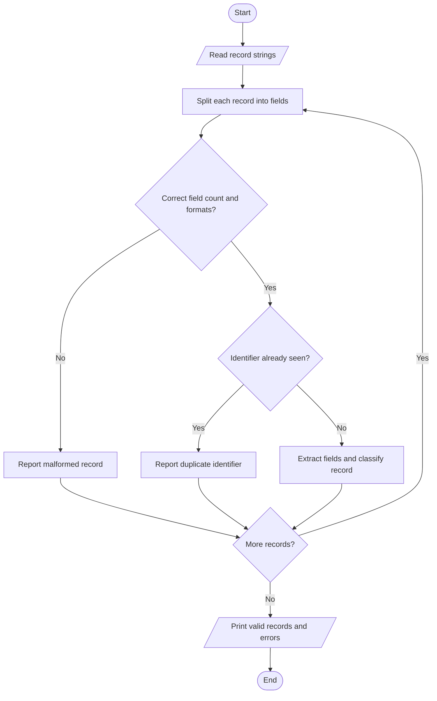
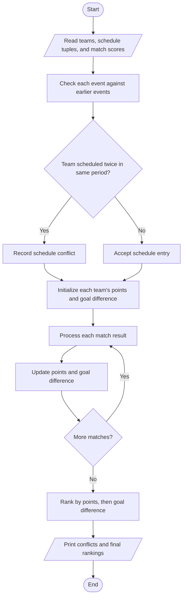
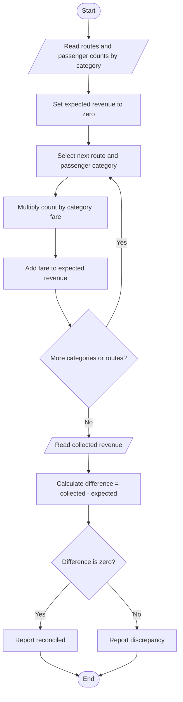
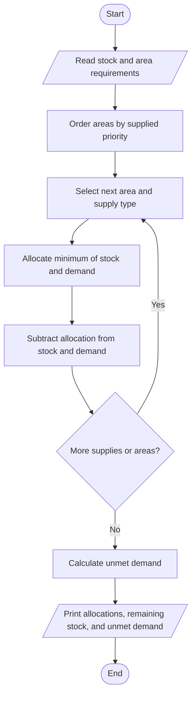
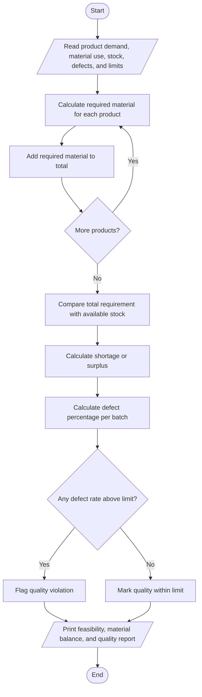
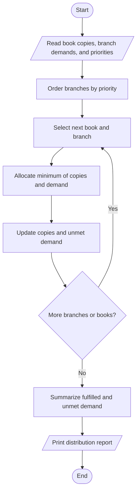
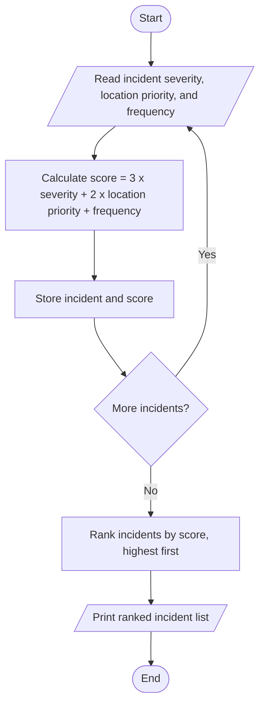
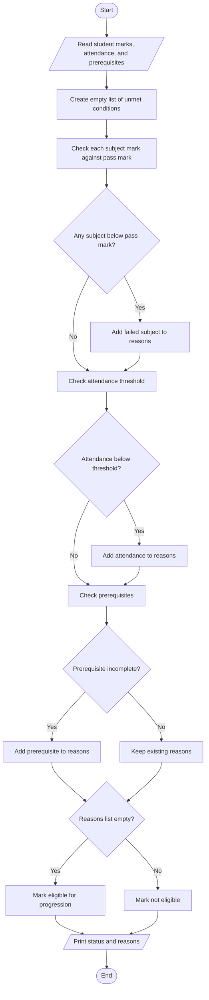
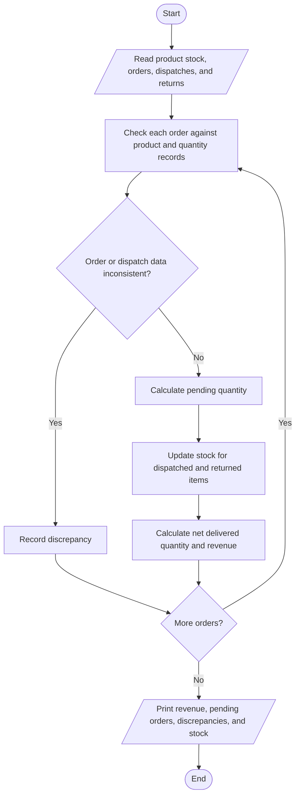
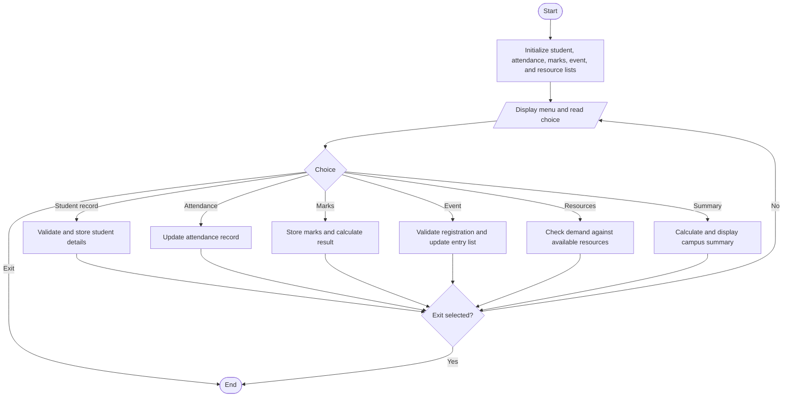

# Flowcharts

These flowcharts are reference designs for the ten selected integrated case studies. The Mermaid syntax renders on GitHub. Adjust any branch or rule that differs from the final program.

## Case study 91

**Advanced String-Based Registration Record Analyzer**

## Case study 92

**Multi-Event Sports Scheduling and Scoring**

## Case study 93

**Smart Public Transport Fare Reconciliation**

## Case study 94

**Disaster Relief Supply Allocation**

## Case study 95

**Integrated Manufacturing Production Planner**

## Case study 96

**Multi-Criteria Library Resource Distribution**

## Case study 97

**Smart Campus Incident and Maintenance Prioritization**

## Case study 98

**University Academic Progression Audit**

## Case study 99

**Integrated E-Commerce Order Processing and Reconciliation**

## Case study 100

**Comprehensive Smart Campus Management Simulation**

